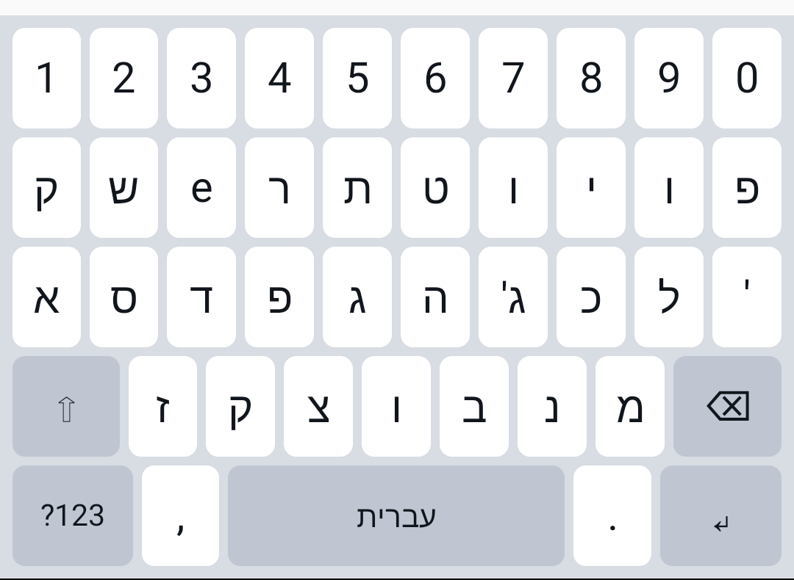

# מקלדת עברית פונטית לאנדרואיד

זאת אותה הפריסה בדיוק של המקלדת לווינדוס שבקובץ

```
he_ph1 - Copy.zip
```

רק שהפעם היא אפליקציה לאנדרואיד: האותיות העבריות יושבות במקומות שבהם הן
יושבות שם, כלומר במקומות של האותיות הלועזיות המקבילות.

טבלת המקשים נקראה ישירות מתוך הקובץ הבינארי של המקלדת לווינדוס, ולא הועתקה
ביד, כך שכל מקש נותן בדיוק את מה שהוא נותן במחשב. הפירוט נמצא במסמך

```
docs/layout.md
```

---

## הקובץ להורדה

```
dist/he-ph1-keyboard.apk
```

קישור ישיר:

```
https://github.com/Rami5743/Ph_He/raw/main/dist/he-ph1-keyboard.apk
```

## ההתקנה — הדרך הקצרה

פשוט לפתוח את הקישור הזה בדפדפן של הטלפון, ללחוץ על ההורדה, ואז על הקובץ
שירד. הטלפון ישאל אם מותר להתקין אפליקציות מהמקור הזה — צריך לאשר פעם אחת,
וזהו.

## ההתקנה דרך הדואר

גוגל חוסמת קבצי התקנה של אנדרואיד כקבצים מצורפים בדואר, גם בתוך קובץ דחוס,
ולכן שליחה עצמית בג'ימייל לא תעבוד. אם בכל זאת רוצים לעבור דרך הטלפון ולא
דרך הדפדפן, אפשר להעלות את הקובץ לדרייב ולפתוח אותו משם.

## אחרי ההתקנה

האפליקציה נפתחת עם שני כפתורים, בסדר שבו צריך ללחוץ עליהם:

הראשון פותח את רשימת המקלדות של הטלפון, ושם צריך להדליק את
"עברית פונטית". הטלפון יזהיר שמקלדת יכולה לראות את מה שמקלידים — זאת
האזהרה הרגילה שמופיעה לכל מקלדת, והמקלדת הזאת לא מבקשת שום הרשאה ולא ניגשת
לרשת בכלל.

השני פותח את בוחר המקלדות, ושם בוחרים אותה ככתיבה הפעילה.

בתחתית המסך יש שדה טקסט שאפשר לנסות בו מיד.

---

## הפריסה



בכל מקש: למעלה מה שיוצא בלחיצה רגילה, למטה מה שיוצא אחרי מקש ההחלפה.

```
 1!   2@   3#   4$   5%   6^   7&   8*   9(   0)

 ק    ש    e    ר    ת    ט    ו    י    ו    פ
 Q    W    E    R    ט    Y    U    I    O    ף

 א    ס    ד    פ    ג    ה    ג'   כ    ל    '
 ע    S    D    ף    G    ח    J    ך    L    "

      ז    ק    צ    ו    ב    נ    מ
      Z    X    ץ    V    B    ן    ם
```

מקש הספרות והסימנים פותח שכבה נוספת עם הספרות, עם סימני הפיסוק של הפריסה
המקורית ועם סימן השקל.

שלושה דברים בפריסה נראים כמו טעות והם נשמרו בכוונה, כי המקלדת בטלפון אמורה
להתנהג בדיוק כמו זאת שבמחשב:

הראשון, המקש של האות הלועזית השלישית בשורה העליונה נותן את האות הלועזית
עצמה ולא אות עברית.

השני, כמה אותיות יושבות על יותר ממקש אחד.

השלישי, כל מקש שאין על ההחלפה שלו אות עברית נותן בהחלפה את האות הלועזית
הגדולה שלו.

אם רוצים לשנות משהו מזה, כל טבלת המקשים נמצאת בקובץ אחד:

```
android/src/org/rami5743/heph1/Layout.java
```

---

## מה יש בתיקיות

```
dist/            קובץ ההתקנה המוכן
android/         קוד המקור של האפליקציה, ותסריט בנייה
tools/           הכלי שקורא את טבלאות המקשים מתוך קובץ ווינדוס
docs/            תיאור הפריסה, והעותק של הקובץ הבינארי שממנו היא נקראה
```

## בנייה מחדש

```
ANDROID_HOME=/path/to/android-sdk ./android/build.sh
```

התסריט משתמש רק בכלים של ערכת הפיתוח של אנדרואיד, בלי גריידל ובלי אף
ספרייה חיצונית, וצריך לו

```
build-tools >= 35, platforms/android-34, JDK
```

מפתח החתימה שבתיקייה

```
android/keystore/
```

נמצא כאן בכוונה, עם הסיסמה שלו גלויה בתוך תסריט הבנייה, כדי שגרסה חדשה
תתקין את עצמה מעל הישנה בלי למחוק אותה קודם. זה מפתח חד־פעמי של האפליקציה
הזאת בלבד ואין לו שום שימוש אחר.
